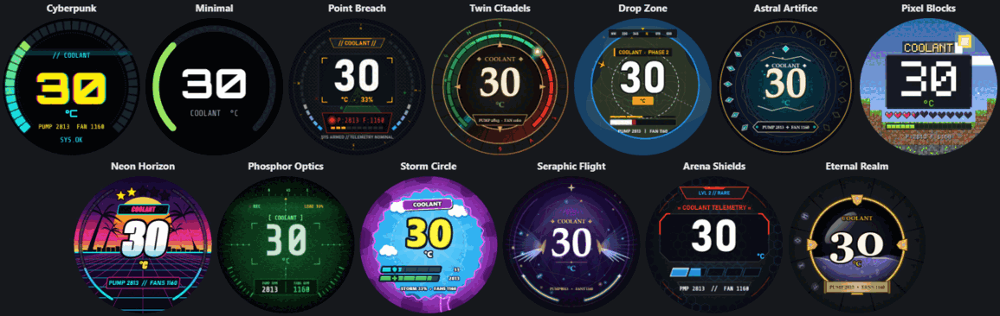
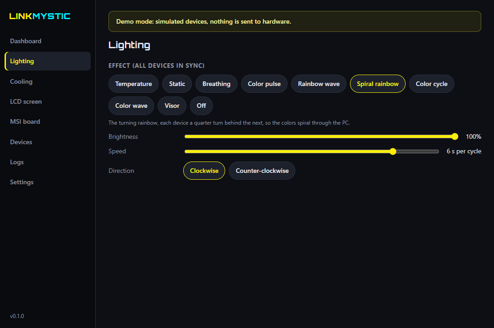
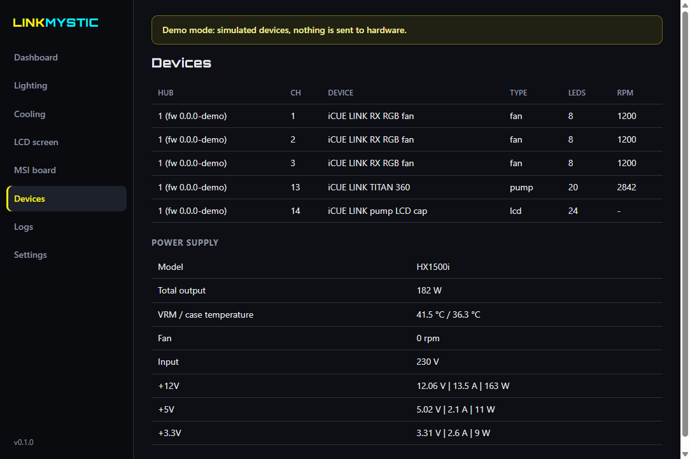

<p align="center"></p>

<h1 align="center">LinkMystic</h1>

<p align="center"><b>Lightweight, open-source RGB sync and fan control for MSI Mystic Light motherboards and Corsair iCUE LINK.</b><br>
One small Windows app instead of iCUE + MSI Center: synced lighting, AIO pump and fan curves, and 13 animated pump LCD themes.</p>

<p align="center">
<a href="../../releases/latest"></a>


</p>


**LinkMystic** syncs the RGB lighting of your **Corsair iCUE LINK** fans, AIO pump and LCD cap with the **ARGB headers of your MSI motherboard** (Mystic Light, JARGB and JAF). It also controls fan and pump speed from the liquid temperature, and turns the **iCUE LINK pump LCD** into a live, animated temperature display. It is a free, open-source **iCUE alternative** (and MSI Center replacement) for these devices, built for gamers who want their RGB to just work without two heavy vendor apps fighting in the background.

> **Status: v0.1, early release.** Tested daily on a Corsair TITAN 360 RX LCD + RX RGB fans + an MSI MAG X870E TOMAHAWK WIFI. It controls your pump and fans, so read [First-time setup](#first-time-setup-important) before you start.

## Contents
- [iCUE and MSI Mystic Light not syncing?](#icue-and-msi-mystic-light-not-syncing-the-problem-linkmystic-solves)
- [Why gamers like it: lightweight by design](#why-gamers-like-it-lightweight-by-design)
- [Features](#features)
- [Customize your Corsair iCUE LINK LCD screen](#customize-your-corsair-icue-link-lcd-screen)
- [Screenshots](#screenshots)
- [Supported hardware](#supported-hardware)
- [Download and install](#download-and-install)
- [First-time setup](#first-time-setup-important)
- [Safety rules](#safety-rules-always-on)
- [FAQ](#faq)
- [How it's made (AI use)](#how-its-made-ai-use)
- [Troubleshooting](#troubleshooting)
- [Build from source](#build-from-source)
- [Credits and license](#credits-and-license)

## iCUE and MSI Mystic Light not syncing? The problem LinkMystic solves

A Corsair iCUE LINK cooler and fans on an MSI motherboard normally means running **two vendor suites at once**: Corsair iCUE for the fans, pump and LCD, and MSI Center with Mystic Light for the motherboard ARGB headers. Sound familiar?

- Your Corsair fans and the fans on the MSI headers **show different colors or drift out of sync**.
- Lights **flicker or stutter** when iCUE and Mystic Light run at the same time.
- Effects or colors **reset after a restart** or when one app updates.
- You want **one RGB effect across the whole PC**, but each app only controls its own devices.

What is going on:

- **RGB out of sync.** Corsair fans and the fans on the MSI ARGB headers run separate effects that drift apart, with different speeds and colors.
- **The two apps fight.** Both talk to the hardware and both start with Windows. When they overlap, effects stutter, colors jump and settings get lost.
- **Background load.** Two suites, their services and their updaters keep running all the time, even in the middle of a game.
- **No simple way to sync Mystic Light with iCUE.** There is no shared effect engine between the two ecosystems.

LinkMystic replaces both with **one app and one effect engine**. Every LED on the Corsair LINK chain and the MSI headers runs the same effect from the same clock, so a rainbow wave really travels through the whole PC.

## Why gamers like it: lightweight by design

| | LinkMystic |
|---|---|
| Background services | **None.** It's one normal app in the tray. |
| Drivers | **None.** It talks to the devices over standard Windows USB HID. |
| Admin rights | **Not needed.** It installs per user. |
| Account, login, cloud | **None.** No sign-in and no online features. |
| Internet / telemetry | **None.** It makes no network connections. |
| CPU while gaming | **Under 1 % of a 24-thread CPU** (measured 0.63 % average, 0.91 % peak over 10 minutes) with lighting at 30 updates per second **and** the pump LCD animating. |
| Memory | About 600 MB working set, 368 MB private, with the animated LCD running (an Electron app, like Discord). |
| Startup | Starts with Windows, minimized to the tray. |

The heavy work is split so it never slows down a game:
- the pump LCD has its own USB thread;
- LCD frames are drawn by a background renderer that takes about 2 ms per frame;
- the cooling loop keeps running even if the window is closed or the LCD renderer restarts.

### Measured against iCUE + MSI Center
Same PC, lighting running, 10 minutes each, sampled every 5 seconds. CPU is the share of all 24 threads.

| | Processes | CPU average (peak) | Memory (working set) | Private memory |
|---|---|---|---|---|
| iCUE | 4 | 0.43 % (0.96 %) | 559 MB | 525 MB |
| MSI Center + Mystic Light | 6 (+3 services) | 0.00 % (0.01 %) | 214 MB | 124 MB |
| **iCUE + MSI Center together** | **10** | **0.43 %** | **773 MB** | **649 MB** |
| **LinkMystic** | **6** | **0.63 % (0.91 %)** | **604 MB** | **368 MB** |

The honest reading: LinkMystic uses about **43 % less private memory** and needs **no services or drivers**. It uses a little more CPU than the vendor apps, because it computes every frame itself to keep Corsair and MSI in one synced effect (30 updates per second) and draws the LCD, while the vendor apps let the hub and the board run their own built-in effects. All of them stay under 1 % of the CPU.

Test PC: Corsair TITAN 360 RX LCD + RX RGB fans, MSI MAG X870E TOMAHAWK WIFI, Windows 11, 26 Oct 2026; iCUE 5 (installer 1.22.16) and MSI Center 2.0.75.0. The measuring script is [docs/benchmark.ps1](docs/benchmark.ps1), so you can repeat it on your own PC.

## Features

### RGB sync across Corsair and MSI
- **10 effects in perfect sync** on iCUE LINK fans, pump ring, LCD-cap ring and MSI ARGB headers: Temperature (your own cool/warm/hot colors), Static, Breathing, Color pulse, Rainbow wave, Spiral rainbow, Color cycle, Color wave, Visor and Off.
- **Smooth 30 updates per second** on Corsair devices, with gamma-corrected fades. Breathing no longer steps near dark.
- **Direction control** (clockwise / counter-clockwise) for the rainbow and wave effects.
- **Clean settings:** each effect shows only the options it actually uses.

### Fan and pump control (AIO cooling)
- **Presets:** Quiet, Balanced, Extreme, or your own **custom fan and pump curves**, set by dragging points on a graph.
- Curves follow the **liquid temperature** from the AIO, which is the right sensor for water cooling.
- **Safety rules that cannot be turned off** (see below).

### MSI Mystic Light motherboard control
- Drives the **JARGB1, JARGB2, JARGB3 and JAF** headers of MSI X870, X870E, B850, B840 and Z890 boards with the "761" lighting controller.
- **Three modes:**
  - the board's own **built-in effects**, perfectly smooth;
  - an **exact copy** of the Corsair effect;
  - **mixed**: exact on the headers you choose, built-in on the rest.
- Set your LED count per header (fans on a splitter count once).

### Pump LCD designer
- **13 animated themes** with live preview (see below), each with its own colors, animation switches and **Restore theme defaults**.
- Show **coolant temperature, pump RPM or fan RPM**, with a gauge that follows the value.
- Or upload your **own image or animated GIF** with a small temperature badge.
- **Off (dark)** turns the screen dark at once.

### And more
- **Corsair HXi / RMi PSU monitoring:** watts, rail voltages and currents, temperatures, fan.
- **Tray app:** it starts with Windows and keeps running when you close the window.
- **Diagnostics in one click:** copies a bug report with serial numbers hidden.
- **Conflict detection:** if iCUE, MSI Center or another RGB tool is running, LinkMystic leaves the device alone and tells you which program to close.

## Customize your Corsair iCUE LINK LCD screen

Turn the 480x480 **iCUE LINK LCD screen** on your AIO pump into a live, animated temperature display: pick one of **13 animated themes**, or show your **own image or animated GIF**. Every gauge follows the live value, and all artwork is drawn in code, with no game assets.



Cyberpunk · Minimal · Point Breach · Twin Citadels · Drop Zone · Astral Artifice · Pixel Blocks · Neon Horizon · Phosphor Optics · Storm Circle · Seraphic Flight · Arena Shields · Eternal Realm · plus **your own image or GIF**.

What you can customize:
- **Show** coolant (liquid) temperature, pump RPM or average fan RPM, with your own gauge range.
- **Colors and animations per theme.** Change the number, gauge and detail colors, and switch effects like glitch, scanlines, embers or lightning on or off. **Restore theme defaults** brings back the original look at any time.
- **Your own picture or GIF:** PNG, JPG, WebP or animated GIF, with a small temperature badge on top. A **square image (480x480 or larger)** looks best; GIFs can have up to 150 frames and 20 MB.
- **Backlight brightness**, frame rate (about 20 fps max) and **Off (dark)**.
- **No iCUE needed.** The screen runs from LinkMystic alone, with a live preview in the app.

Works with the **iCUE LINK LCD screen** (USB 1B1C:0C4E). Tested on the TITAN 360 RX LCD; expected on other iCUE LINK AIOs with the LCD screen module. The older **ELITE LCD** coolers use a different screen and are not supported yet.

## Screenshots

*Screenshots from demo mode (simulated devices).*

| Lighting | Cooling curves |
|---|---|
|  |  |
| **Pump LCD designer** | **MSI Mystic Light headers** |
|  |  |
| **Devices and PSU** | **Dashboard** |
|  |  |

## Supported hardware

| Family | What LinkMystic does | Notes |
|---|---|---|
| Corsair **iCUE LINK System Hub** | Lighting, fan and pump control, liquid temperature | TITAN and H-series AIOs, QX / LX / RX / RX MAX fans, XD5 / XD6 / XC7 / XG7, LCD caps, 5000T / 9000D cases |
| Corsair **iCUE LINK pump LCD** | Animated themes, image / GIF | 480x480, about 20 fps |
| **MSI** X870 / X870E / B850 / B840 / Z890 motherboards (Mystic Light "761" controller) | JARGB1-3 and JAF ARGB headers | About 35 boards. Other MSI boards are **detected but never written to**. |
| Corsair **HXi / RMi** power supplies | Monitoring only | Never changes PSU settings |

The full list, including the exact MSI models and what is tested vs expected, is in **[docs/SUPPORTED_HARDWARE.md](docs/SUPPORTED_HARDWARE.md)**. Is your device missing? Open a [Device support](../../issues/new/choose) issue with your diagnostics.

Not supported yet: Commander Core / Commander Pro, Corsair RAM, keyboards and mice, older MSI boards, MSI onboard LEDs and the 12 V JRGB header. [OpenRGB](https://openrgb.org) covers many of those.

## Download and install

1. Download **`LinkMystic-Setup-x.y.z.exe`** from **[Releases](../../releases/latest)**. Each release lists its SHA-256 checksum and carries a GitHub build-provenance attestation (see [SECURITY.md](SECURITY.md)).
2. Run it. It installs for your user only, so no admin prompt appears. LinkMystic is not code-signed yet, so Windows may show **"Windows protected your PC"**: click **More info → Run anyway**.
3. Start **LinkMystic** from the desktop or the Start menu. It lives in the tray next to the clock.

To uninstall, go to *Settings → Apps → LinkMystic → Uninstall*. Your settings stay in `%APPDATA%\LinkMystic` unless you delete that folder.

## First-time setup (important)
1. **Store a safe profile in your LINK hub first.** Open iCUE once, select your AIO and turn on **Device Memory Mode**. Set the pump to **Balanced or Extreme** and the fans to **Balanced**. If LinkMystic ever stops, the hub runs this stored profile on its own.
2. **Close iCUE and MSI Center** and turn off their autostart, or uninstall them. LinkMystic leaves any device alone while other RGB or fan software is using it, and shows which program to close.
3. **Install and open LinkMystic.** The *Dashboard* should show liquid temperature, pump and fan speeds.
4. On the **MSI board** tab, tick the headers you use and enter their LED counts (for example, 3 fans × 12 LEDs = 36).

## Safety rules (always on)
- The pump never runs below **70 %**, and fans never below **20 %**.
- If the liquid goes above **50 °C**, the temperature reading is lost, or the pump stalls, pump and fans go to **100 %** and the lights flash red.
- On quit, crash or unplug, the LINK hub returns to its **stored profile** (Device Memory Mode). The engine restarts itself after a crash.
- Unknown MSI boards are never written to. PSU settings are never changed.

## FAQ

**Is LinkMystic an alternative to Corsair iCUE and MSI Center?**
For the supported devices, yes. It covers lighting, fan and pump curves, the pump LCD and Mystic Light ARGB headers, so you can uninstall both suites. You only need iCUE once, to store the safe hardware profile (Device Memory Mode).

**Can I sync Corsair iCUE LINK fans with MSI Mystic Light?**
Yes. That is the main reason LinkMystic exists. One effect engine drives both, so colors and motion stay in sync.

**Will it slow down my games?**
No. It uses under 1 % of a 24-thread CPU with all lighting and the LCD animating (see [the measurements](#measured-against-icue--msi-center)), runs no services or drivers, and makes no network connections.

**Does it work with my MSI motherboard?**
It works with MSI X870, X870E, B850, B840 and Z890 boards that use the "761" Mystic Light controller; check [the list](docs/SUPPORTED_HARDWARE.md). Other MSI boards are detected and left untouched.

**Can I put a GIF or my own picture on the Corsair pump LCD?**
Yes. Pick *Image / GIF* on the LCD screen tab. Animated GIF, PNG, JPG and WebP all work, with a small temperature badge on top.

**Which Corsair LCD screens are supported?**
The **iCUE LINK LCD screen** on iCUE LINK AIOs (tested on the TITAN 360 RX LCD). The older ELITE LCD coolers use a different screen and are not supported yet; please open a [Device support](../../issues/new/choose) issue if you have one.

**Can the LCD show CPU or GPU temperature?**
Not yet. It shows the coolant temperature from the AIO, pump RPM or fan RPM. Coolant temperature is what the fan and pump curves use, and it reacts more calmly than CPU spikes.

**Do I need iCUE running for the LCD or the lighting?**
No. You only need iCUE once, to store the safe hardware profile (Device Memory Mode). After that, LinkMystic drives the LCD, lighting, fans and pump on its own.

**Is it safe for my AIO?**
It enforces minimum pump and fan speeds, fails safe to 100 % on any problem, and hands the hub back to its stored profile when it stops (see [Safety rules](#safety-rules-always-on)). It is still a v0.1 release, so set up the safe hardware profile first.

**Why does Windows show a SmartScreen warning?**
The installer is not code-signed yet. The release is built by a public GitHub workflow, and you can verify it with its checksum and build attestation.

**How is this different from OpenRGB or SignalRGB?**
OpenRGB supports far more devices and is great for lighting. LinkMystic focuses on one popular combination, iCUE LINK plus MSI X870/B850-era boards, and adds what those setups need beyond lighting: AIO pump and fan curves with safety rules, and an animated pump LCD.

**How is LinkMystic different from OpenLinkHub?**
[OpenLinkHub](https://github.com/jurkovic-nikola/OpenLinkHub) is a mature, open-source **Linux** app for Corsair hubs, AIOs and peripherals, and LinkMystic learned from its protocol work. LinkMystic is for **Windows** and focuses on one thing OpenLinkHub does not do: syncing Corsair iCUE LINK with **MSI Mystic Light** motherboard headers from one effect engine, plus animated pump LCD themes. On Linux, use OpenLinkHub.

**Is there a Linux version?**
No, Windows 10/11 only for now. On Linux, [OpenLinkHub](https://github.com/jurkovic-nikola/OpenLinkHub) already covers Corsair devices very well.

**Does it support the new 5-inch iCUE LINK LCD screen module?**
Not yet. If you have one, please open a [Device support](../../issues/new/choose) issue with your diagnostics (Logs → Copy diagnostics).

## How it's made (AI use)
LinkMystic is designed, directed and tested by me on my own PC. The code is written with the help of **Claude**, Anthropic's AI coding assistant, which is why it appears as a contributor. Every change is tested on real hardware before a release, the full source is public, and each installer is built by a public GitHub workflow with checksums and a build attestation, so you can verify exactly what you run.

## Troubleshooting
- **Nothing found, or a yellow banner:** another program (iCUE, Corsair Service, MSI Mystic Light, SignalRGB, OpenRGB, FanControl) is using the devices. Close it.
- **MSI lights step or stutter:** the MSI controller accepts about 10 updates per second in total. Use *Built-in effects* or *Mixed* mode on the MSI board tab.
- **Anything else:** go to Logs → **Copy diagnostics**, then open an [issue](../../issues/new/choose) and paste it.

## Build from source
```
npm ci
npm test              # protocol + safety tests, no hardware needed
npm run demo          # run with simulated devices
npm run themes:preview  # render every LCD theme to theme-sheet.png
npm run dist          # build the Windows installer into dist/
```
Requires Node.js 24 and Windows 10/11 x64. Want to add an LCD theme? See [CONTRIBUTING.md](CONTRIBUTING.md).

## Credits and license
LinkMystic is free software under the **GNU GPL v3 or later** (see [LICENSE](LICENSE)). The device protocols were learned from the excellent work of [OpenRGB](https://gitlab.com/CalcProgrammer1/OpenRGB) (GPL-2.0-or-later), [OpenLinkHub](https://github.com/jurkovic-nikola/OpenLinkHub) (GPL-3.0), [liquidctl](https://github.com/liquidctl/liquidctl) (GPL-3.0) and [SignalRGB](https://signalrgb.com). Third-party components are listed in [THIRD_PARTY_NOTICES.md](THIRD_PARTY_NOTICES.md).

LinkMystic is not affiliated with, endorsed by or supported by Corsair or MSI. Corsair, iCUE, MSI and Mystic Light are trademarks of their owners and are used here only to describe compatibility. The LCD themes are original artwork and are not connected to any game or publisher.
