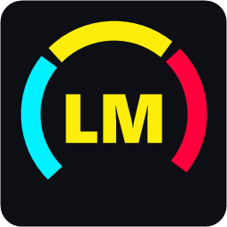
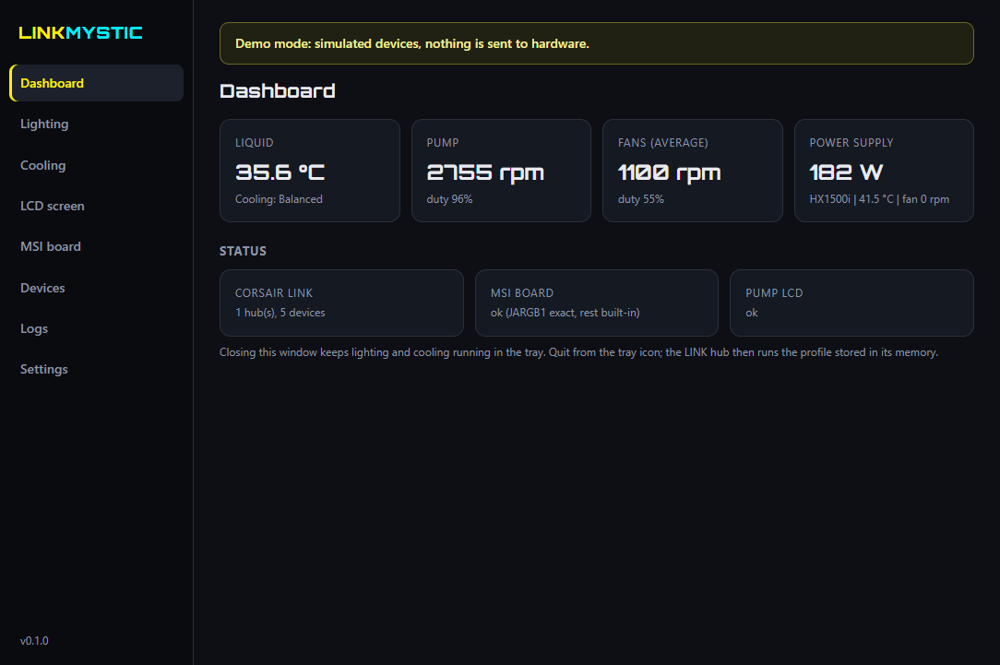
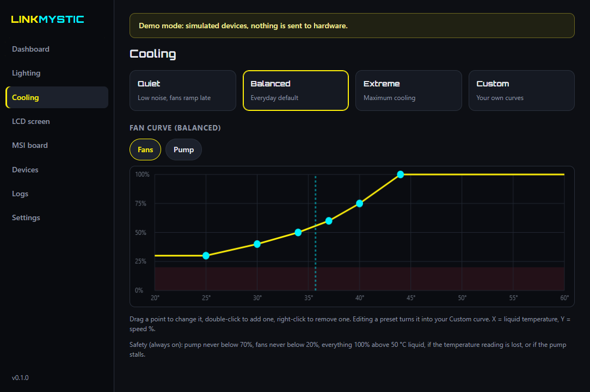
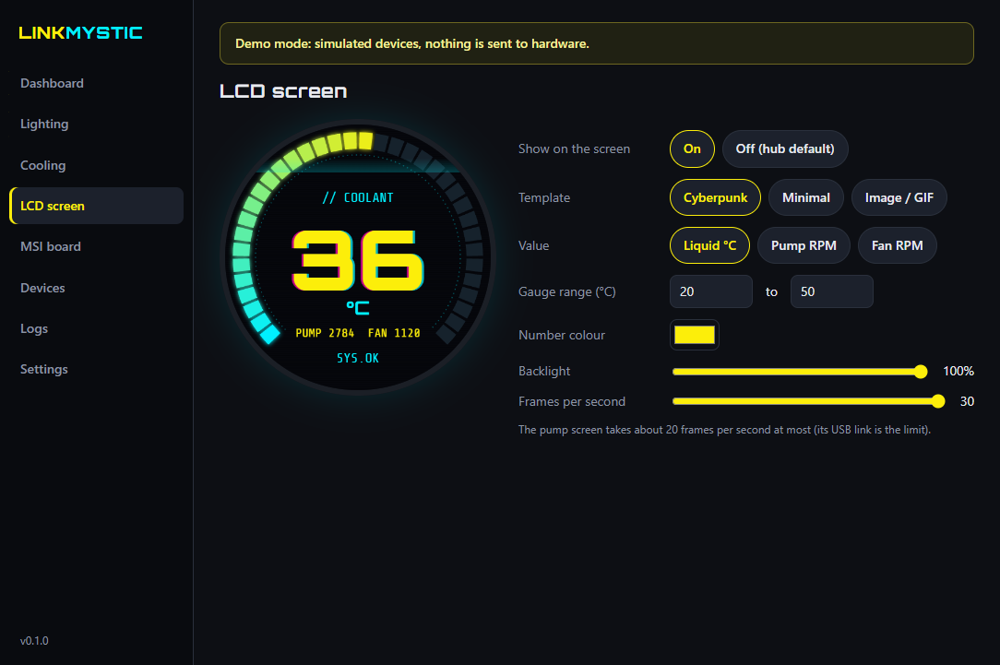
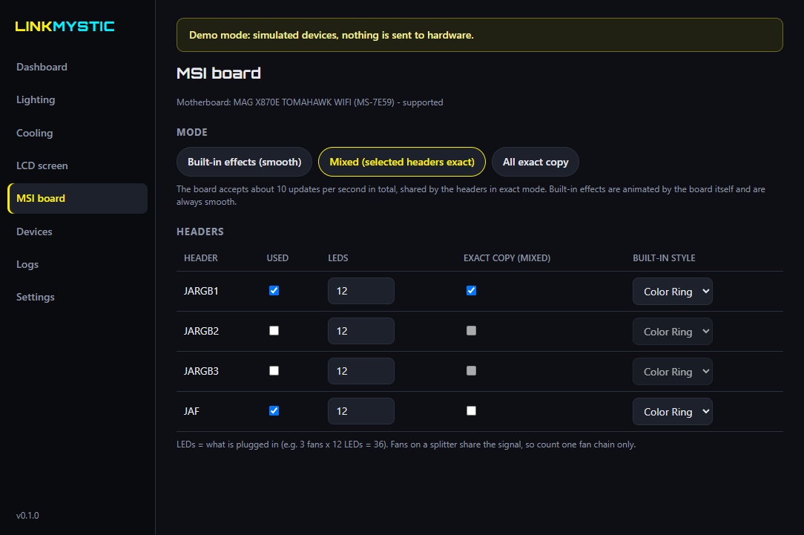

<p align="center"></p>

# LinkMystic

**One small Windows app instead of Corsair iCUE + MSI Mystic Light.**
Lighting, fan and pump control and the pump LCD for **Corsair iCUE LINK**, the RGB headers of newer **MSI motherboards**, and read-only monitoring of **Corsair HXi/RMi power supplies**: all in sync, from one window, with no fighting between programs.

> **Experimental (v0.1).** LinkMystic controls your AIO pump and fans. It has strong safety rules (below), but it is new and has been tested on a small number of systems. Use it at your own risk and read *First-time setup* before you start.



## Why?
iCUE and MSI Center both want to control the same lights, and when both run they fight: lights go dark, effects stutter, profiles reset. LinkMystic replaces both with one lightweight app that talks to the hardware directly.

## Features
- **Lighting in sync** across iCUE LINK fans, pump ring, LCD-cap ring and the MSI board headers: Rainbow wave, Static, Breathing, Colour cycle, Temperature (green/yellow/red), Off.
- **Cooling presets** Quiet / Balanced / Extreme, or your own **Custom curve** (drag the points), for fans and pump.
- **Pump LCD designer**: Cyberpunk and Minimal templates, or your own **image or animated GIF**, with a live preview, about 20 fps.
- **MSI board modes**: the board's own smooth built-in effects, an exact copy of the Corsair look, or a mix.
- **PSU monitoring** (HXi/RMi): watts, rail voltages and currents, temperatures, fan.
- **Tray app**: starts with Windows and keeps running when you close the window.
- **Diagnostics button**: one click copies a bug report (serial numbers hidden).

| Cooling | LCD designer | MSI board |
|---|---|---|
|  |  |  |

## Supported hardware
| Family | Supported | Notes |
|---|---|---|
| Corsair **iCUE LINK System Hub** | Lighting, fan + pump control, liquid temperature | H100i–H170i, TITAN 240–420 (incl. RX/LCD), QX/LX/RX/RX MAX fans, XD5/XD6/XC7/XG7, LCD caps, 5000T/9000D cases. See [docs/SUPPORTED_HARDWARE.md](docs/SUPPORTED_HARDWARE.md). |
| Corsair **iCUE LINK pump LCD** | Custom screen | 480x480, about 20 fps |
| **MSI** X870 / X870E / B850 / B840 / Z890 boards with the "761" lighting controller | JARGB1-3 + JAF headers | About 35 boards; any other MSI board is **detected but never written to**. |
| Corsair **HXi / RMi** PSU | Monitoring only | Never changes PSU settings |

Not supported (yet): other Corsair devices (Commander Core, RAM, keyboards, mice), older MSI boards, MSI onboard LEDs, the 12 V JRGB header. Use [OpenRGB](https://openrgb.org) for those, or open a *Device support* issue.

## First-time setup (important)
1. **Store a safe profile in your LINK hub first.** Open iCUE once, select your AIO, turn on **Device Memory Mode**, and set the pump to **Balanced or Extreme** and the fans to **Balanced**. If LinkMystic ever stops, the hub runs this stored profile on its own.
2. **Close iCUE and MSI Center's lighting**, and turn off their autostart (or uninstall them). LinkMystic leaves any device alone while other RGB/fan software is running, and shows a yellow banner telling you which program to close.
3. **Install LinkMystic** (below), open it, and check the *Dashboard*: liquid temperature, pump and fan speeds should show.
4. On the **MSI board** tab, tick the headers you use and enter their LED counts (for example 3 fans x 12 LEDs = 36).

## Install
1. Download `LinkMystic-Setup-x.y.z.exe` from [Releases](../../releases). The release page also lists the SHA-256 checksum.
2. Run it. LinkMystic is not code-signed yet, so Windows may show **"Windows protected your PC"**: click **More info -> Run anyway**.
3. Start **LinkMystic** from the desktop or Start menu. It appears in the tray (next to the clock).

To uninstall: *Settings -> Apps -> LinkMystic -> Uninstall*. Your settings stay in `%APPDATA%\LinkMystic` unless you delete that folder.

## Safety rules (always on, cannot be turned off)
- The pump never runs below **70 %**; fans never below **20 %**.
- If the liquid goes above **50 °C**, the temperature reading is lost, or the pump stalls (under 1000 rpm three times in a row), pump and fans go to **100 %** and the lights flash red.
- On quit, crash or unplug, the LINK hub is handed back to its **stored profile** (Device Memory Mode). The engine restarts itself after a crash.
- Unknown MSI boards are never written to. PSU settings (OCP, fan mode) are never changed.

## Troubleshooting
- **Nothing found / yellow banner:** another program (iCUE, Corsair Service, MSI Mystic Light, SignalRGB, OpenRGB, FanControl) is using the devices. Close it.
- **MSI lights step or stutter:** the MSI controller takes about 10 updates per second in total. Use *Built-in effects* or *Mixed* mode on the MSI board tab.
- **Something else:** Logs -> **Copy diagnostics**, then open an [issue](../../issues/new/choose) and paste it.

## Build from source
```
npm ci
npm test            # packet + safety tests, no hardware needed
npm run demo        # run with simulated devices
npm run dist        # build the Windows installer into dist/
```
Requires Node.js 24 and Windows 10/11 x64.

## Credits and licence
LinkMystic is free software under the **GNU GPL v3 or later** (see [LICENSE](LICENSE)). The device protocols were learned from the excellent work of [OpenRGB](https://gitlab.com/CalcProgrammer1/OpenRGB) (GPL-2.0-or-later), [OpenLinkHub](https://github.com/jurkovic-nikola/OpenLinkHub) (GPL-3.0), [liquidctl](https://github.com/liquidctl/liquidctl) (GPL-3.0) and [SignalRGB](https://signalrgb.com). Third-party components: [THIRD_PARTY_NOTICES.md](THIRD_PARTY_NOTICES.md).

LinkMystic is not affiliated with, endorsed by or supported by Corsair or MSI. Corsair, iCUE, MSI and Mystic Light are trademarks of their owners and are used here only to describe compatibility.
